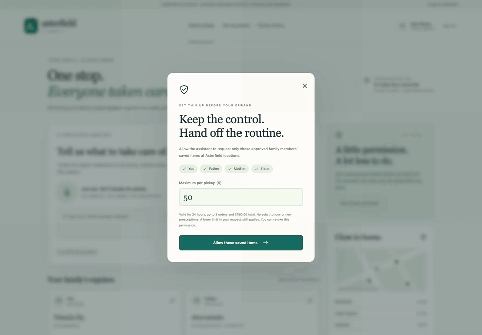
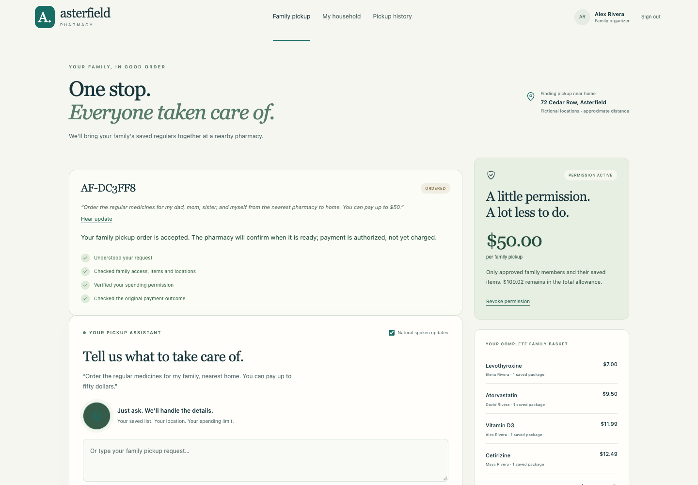
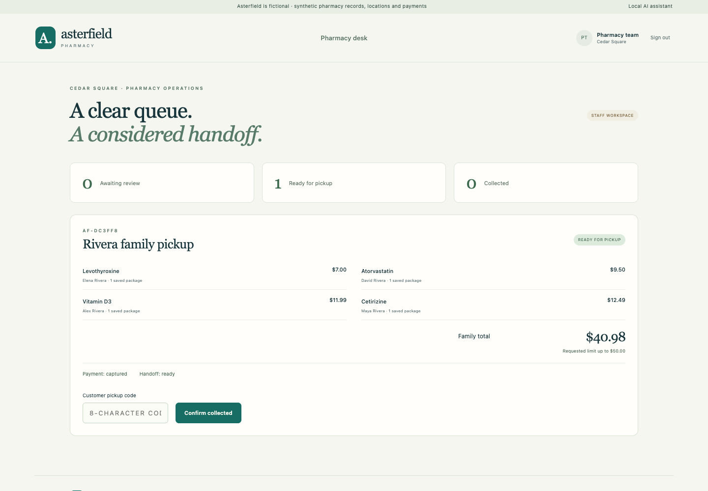

# Agentic Commerce

### One request. A whole family’s pickup, handled.

[](https://github.com/sontiachyut/agentic-commerce-platform/actions/workflows/verify.yml)

**Asterfield Family Pickup** is the first working product built on this platform: a voice-enabled pharmacy assistant that turns a household request into an authorized order, a pharmacy staff task and a confirmed pickup.

> “Order the regular medicines for Dad, Mom, my sister and me from the nearest pharmacy to home. You can pay up to fifty dollars.”

The agent understands the request. The backend checks the saved items, family access, stock, location and spending permission. Pharmacy staff prepare the order, and the customer receives a verified pickup confirmation.

## ▶ Watch the complete demo

**3 minutes 57 seconds · narrated · real running customer and pharmacy screens.**

*18-second silent preview. Select it to open the complete narrated video.*

[](https://raw.githubusercontent.com/sontiachyut/agentic-commerce-platform/main/docs/demo/family-pickup-demo.mp4)

[**Watch / download the full video**](https://raw.githubusercontent.com/sontiachyut/agentic-commerce-platform/main/docs/demo/family-pickup-demo.mp4) · [Captions](docs/demo/family-pickup-demo.srt) · [Demo walkthrough](docs/pharmacy/demo-guide.md)

| Time | What you’ll see |
| --- | --- |
| **00:17** | Four family members and their saved routines |
| **00:35** | Explicit spending permission before the errand |
| **00:52** | A $35 request stops because the complete basket costs $40.98 |
| **01:09** | A spoken $50 request moves through recognition and the agent workflow |
| **02:12** | The complete basket is accepted at the nearest eligible pharmacy |
| **02:33** | Staff review and prepare the order before payment capture |
| **02:49** | The customer receives ready status, location and a pickup code |
| **03:18** | Staff verify collection; the customer sees a completed pickup |

*Asterfield is fictional. All people, prescription records, prices, locations, payments and handovers are synthetic. The recorded customer command and narration use supplied neural voices; recognition, AI interpretation, backend processing and staff actions run through the actual application.*

## What works today

**A complete local product, from the first request to the final handover.**

| For the customer | For the pharmacy team |
| --- | --- |
| Speak or type a family pickup request | Work from a facility-scoped order queue |
| Retrieve approved family members’ saved items | Review eligibility and prepare the complete basket |
| Set per-order, total, count and expiry limits | Confirm readiness before payment capture |
| Find the nearest open location with every item | Verify the customer’s pickup code before handover |
| Hear natural spoken updates and view pickup history | Follow recorded payment and fulfillment status |

The standard demo orders **four saved packages for $40.98** at Cedar Square. A closer location is skipped because it cannot fill the complete basket. The system preserves a lower budget in the request even when a larger standing permission exists.

<details>
<summary><strong>See the customer and staff workspaces</strong></summary>

**Customer — an accepted family order, its exact basket and spending allowance**



**Pharmacy — the same basket, confirmed payment and pickup verification**



</details>

## Built to finish the task

A convincing answer is only one step. The system also has to keep the purchase correct when requests repeat, stock changes or a payment response disappears.

- **Authority stays explicit.** Caregiver access and spending permission are separate; the model cannot create either.
- **The whole basket matters.** No dropped family member, invented copay or automatic medication substitution to make a budget fit.
- **One quote leads to one order.** Inventory, refill and budget holds commit atomically; duplicate acceptance returns the original order.
- **Uncertainty stays visible.** A timeout triggers source inquiry with the same command identity. It does not become a second payment.
- **Completion means something.** Accepted, prepared, paid, ready and collected remain distinct facts.

**Verified on November 4, 2026:** 100 backend tests, 10 local browser tests, actual local speech recognition/neural playback, and a two-database restore rehearsal with matching data fingerprints. [Verification report](docs/verification-report.md) · [Measured demo evidence](results/pharmacy/2026-11-04-local.json)

## Coming soon

The next step is making this working slice easier to adapt to a pharmacy’s own workflow.

| Next up — planned | What it unlocks |
| --- | --- |
| Configurable pharmacies, households and saved routines | Demonstrate a client’s workflow without changing the core engine |
| Faster, streaming voice with interruption handling | A more fluid conversation while the workflow runs |
| Refill and coverage blocker coordination | Follow a blocked request through an authorized resolution process |
| Customer notifications | Receive a ready-for-pickup update beyond the open browser |
| Pharmacy and payment adapters | Replace synthetic providers through approved client integrations |

These are roadmap items, not features in the current demo. Integration work depends on the client’s systems, permissions and provider contracts; no release dates are promised.

## The bigger vision

**Finish the errand before you reach the counter.**

Imagine leaving work, asking for the family’s regular items, and letting an assistant coordinate the pickup within the people, locations and budget you have already approved. Your phone, home assistant or future in-car interface becomes another way to reach the same reliable workflow.

Family Pickup is the first standalone product in that direction. The platform separates household access, saved routines, location selection, purchasing authority, payment, fulfillment and notifications so each capability can grow independently and connect to the next.

Native CarPlay, live pharmacy/payer connections and real-money payments are later milestones. The browser voice experience shown here is the working foundation for that vision.

## Under the hood

| Layer | Current implementation |
| --- | --- |
| Customer and staff apps | React + TypeScript |
| API and validation | Python, FastAPI, Pydantic |
| Agent workflow | LangGraph + structured interpretation through the owner’s signed-in Codex CLI |
| Business state and recovery | PostgreSQL, SQLAlchemy, Alembic, durable workers and source inquiry |
| Voice | Local whisper.cpp recognition + Qwen3-TTS/MLX natural speech on Apple Silicon |
| Identity and tools | Revocable sessions/CSRF, optional local OIDC, read-only MCP |
| Verification and packaging | pytest, Playwright, automated accessibility checks, Docker, GitHub Actions |

Speech runs locally. Codex model inference uses the owner’s signed-in service and requires connectivity. A hosted client product needs a supported inference arrangement; the subscription integration is an owner-operated local profile.

<details>
<summary><strong>Run it locally</strong></summary>

Prerequisites: Python 3.12, uv, Node 22+ and Docker/Compose. AI mode additionally needs an eligible signed-in Codex CLI; a deterministic baseline runs without an LLM.

```bash
uv sync --locked
uv run python tools/dev.py init
docker compose -p agentic-commerce up -d postgres
uv run alembic upgrade head
npm ci --prefix web
npm run build --prefix web
uv run python tools/stack.py up --provider codex
```

Open **http://127.0.0.1:8510**. In demo-auth mode, choose **Explore family pickup**, configure permission and submit a request. Sign out and choose **Open the pharmacy desk** to prepare and hand over the same order.

For existing least-privilege installations, use `uv run python tools/database.py migrate` instead of migrating with the runtime account. [OIDC and packaging](docs/local-identity-and-packaging.md).

For local voice, install CMake/a C++ compiler, then:

```bash
uv run python tools/install_voice.py
uv run python tools/install_neural_voice.py  # optional Apple Silicon profile; ~2 GB weights
```

Restart the API after provisioning. The microphone is bounded to 45 seconds. Text remains available when recognition or speech cannot run. To switch to the rule baseline:

```bash
uv run python tools/stack.py down
uv run python tools/stack.py up --provider baseline
```

[Setup and recovery](docs/operations-runbook.md) · [Repeat the recorded demonstration](docs/pharmacy/demo-guide.md)

</details>

<details>
<summary><strong>Run the engineering checks</strong></summary>

```bash
uv run ruff check src tests tools migrations
uv run ruff format --check src tests tools migrations
uv run pytest -q
npm run build --prefix web
npm exec --prefix web -- playwright install chromium
uv run python tools/browser_check.py --product pharmacy
uv run python tools/browser_check.py  # preserved retail regression
```

Browser helpers use disposable databases and preserve the main inventory/history. Voice acceptance additionally needs the provisioned local runtimes and synthetic audio fixture. CI runs both products without an inference subscription; local voice checks are separately exercised on the provisioned Mac.

</details>

## Engineering library

| Read next | Purpose |
| --- | --- |
| [Current status](docs/STATUS.md) | Implemented, verified and outstanding work |
| [Product brief](docs/pharmacy/product-brief.md) | User problem, standalone scope and larger vision |
| [Pharmacy architecture](docs/pharmacy/architecture.md) | Domain boundaries, state ownership and failure handling |
| [API reference](docs/api-reference.md) | Authentication, contracts and retry semantics |
| [Research](docs/pharmacy/research.md) | Primary workflow references and voice-runtime decisions |
| [Operations](docs/operations-runbook.md) / [Security](SECURITY.md) | Local operation, recovery and release boundaries |
| [Protocol support](docs/protocol-support.md) | Exact AP2/TAP-style/UCP/ACP/MCP implementation boundaries |

The earlier retail engine and its signed interoperability work remain preserved at `checkpoint/retail-engine-before-pharmacy-2026-11-04`. Pharmacy batch orders currently use internal quotes and permissions; the external commerce adapters are not yet their execution path. The Java payment project remains complementary, not a runtime dependency.

**Current release:** a working local synthetic demonstration. Live clinical/insurance/payment processing, public hosting, production operational review, commercial licensing and native CarPlay approval remain separate release gates.
