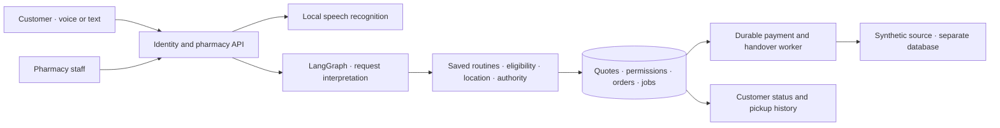

# Asterfield Pharmacy — Family Pickup

An original pharmacy pickup product built on Agentic Commerce. One household request becomes an authorized basket, a pharmacy staff task, and a confirmed handover. Voice and text use the same persistent workflow.

> “Order the regular medicines for Dad, Mom, my sister and me from the nearest pharmacy to home. You can pay up to fifty dollars.”

The local demonstration retrieves four **synthetic saved routines**, selects the nearest location able to fill the complete basket, and places a $40.98 order within a separate recorded permission. Staff review and prepare it before payment capture. A customer pickup code confirms the eventual handover. An order being accepted, being ready, and being collected are different states.

**Working local synthetic candidate.** Asterfield is fictional. Existing refill eligibility, copays, inventory, payment and fulfillment are simulated; no real patient data or funds are used. The application does not prescribe, give clinical advice, substitute treatments, connect to CVS/Walmart, or claim native CarPlay approval. [Current verified status](docs/STATUS.md).

## Run locally

Python 3.12, uv, Node 22+, Docker with Compose. AI mode uses the owner's already signed-in Codex CLI under its normal allowance; the deterministic baseline needs no LLM. This is an owner-operated local integration, not a transferable hosted inference API.

```bash
uv sync --locked
uv run python tools/dev.py init
docker compose -p agentic-commerce up -d postgres
uv run alembic upgrade head
npm ci --prefix web
npm run build --prefix web
uv run python tools/stack.py up --provider codex
```

Open **http://127.0.0.1:8510**. In demo-auth mode choose **Explore family pickup**, configure pickup permission, then type the request above. Choose **Open the pharmacy desk** after signing out to prepare and hand over the same order. Optional local OIDC is described in [identity and packaging](docs/local-identity-and-packaging.md). For an existing least-privilege installation, use `uv run python tools/database.py migrate` rather than running migrations with the runtime account.

For local voice input, install CMake and a C++ compiler, then provision the pinned executable and checksum-verified English model:

```bash
uv run python tools/install_voice.py
uv run python tools/install_neural_voice.py  # optional Apple Silicon natural voice (~2 GB weights)
```

Restart the API if necessary. The microphone records at most 45 seconds; speech recognition runs locally through whisper.cpp. A keyboard fallback remains available. Qwen3-TTS with a supplied Ryan preset reads backend-confirmed status locally without listing relatives' medication names. Its optional Apple Silicon environment is separate from the API; spoken output falls back to written status if unavailable. Recognition quality on one synthetic command does not establish medical vocabulary accuracy or broad accent/device coverage.

Use `--provider baseline` for deterministic development. Stop before switching providers:

```bash
uv run python tools/stack.py down
uv run python tools/stack.py up --provider baseline
```

The lifecycle commands preserve PostgreSQL volumes and business history. [Operations and recovery](docs/operations-runbook.md).

## What the product does

- Separates approved per-person caregiver access from authority to purchase saved items.
- Uses fixed existing refill/OTC packages and confirmed synthetic prices; blocks too-soon refills, exhausted refills, unresolved coverage and changed access.
- Chooses the nearest open location able to supply the whole basket; uses labeled straight-line distance, not traffic navigation.
- Preserves strict “under” versus inclusive “up to” limits. A higher standing permission never overrides a lower request budget.
- Validates immutable quote terms, reserves stock/refills/budget atomically, and binds duplicate acceptance to one order.
- Keeps payment authorization, staff preparation, capture, readiness and verified handover separate.
- Recovers uncertain provider outcomes through stable commands and source inquiry; a lost response is not treated as a decline.
- Provides customer history, a facility-scoped staff queue, audit records, server-side sessions, CSRF controls and read-only MCP tools.
- Interprets requests with a bounded LangGraph/local Codex workflow. The model cannot pick a new treatment, create spending permission or declare a transaction successful.



## Demonstrate and verify

A complete client video is a release deliverable, not a substitute for a working product. The [demo guide](docs/pharmacy/demo-guide.md) describes the customer and staff journey, reproducible capture, evidence and integration boundaries.

```bash
uv run ruff check src tests tools migrations
uv run ruff format --check src tests tools migrations
uv run pytest -q
npm run build --prefix web
npm exec --prefix web -- playwright install chromium
uv run python tools/browser_check.py --product pharmacy
uv run python tools/browser_check.py  # preserved retail engine regression
```

Browser helpers use disposable databases and preserve the main demonstration's inventory/history. Voice acceptance additionally requires the provisioned recognizer and the synthetic audio fixture described in the demo guide. CI runs both products without requiring an inference subscription.

## Preserved engine and protocols

The pre-pharmacy retail engine remains at checkpoint `checkpoint/retail-engine-before-pharmacy-2026-11-04` (`4e077c9`) and can run with `COMMERCE_PRODUCT_MODE=retail`. Its signed AP2 profile, RFC 9421/TAP-style recognition and UCP/ACP synthetic contract adapters are preserved engineering capabilities. **The pharmacy batch workflow does not yet route through those external protocol adapters.** Its internal quotes and permissions are not relabeled AP2 mandates. Pharmacy MCP exposes `get_family_regulars` and `get_family_pickup_status`; neither approves or pays.

[Exact protocol support](docs/protocol-support.md). The Java payment project is a complementary future integration, not a runtime dependency.

## Read next

| Document | Purpose |
| --- | --- |
| [Verified status](docs/STATUS.md) | Current capabilities, measurements and remaining gates |
| [Pharmacy brief](docs/pharmacy/product-brief.md) | User problem, standalone product and larger vision |
| [Pharmacy architecture](docs/pharmacy/architecture.md) | State ownership, trust boundaries and failure handling |
| [Pharmacy API and demo](docs/pharmacy/demo-guide.md) | Run the complete customer/staff journey |
| [Research](docs/pharmacy/research.md) | Primary workflow references and original design decisions |
| [Verification](docs/verification-report.md) | Current evidence and preserved historical results |
| [Operations](docs/operations-runbook.md) / [Security](SECURITY.md) | Local setup, recovery and release boundaries |
| [Engineering guide](docs/engineering-guide.md) | Preserved engine concepts and tradeoffs |

Commercial hosting, supported hosted inference, real pharmacy/payer/payment integration, approved native CarPlay, distribution licensing and production operational review remain separate gates. A narrated synthetic demo is not evidence of those capabilities.
