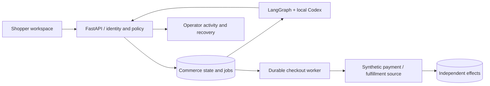

# Agentic Commerce

A purchasing workspace where an agent can find an item, prepare an exact quote and coordinate a purchase within the user's authority. Deterministic backend rules control money, inventory and execution; confirmed source states control what the user is told.

**v0.1: working local demonstration, using synthetic products, payments and fulfillment.** It is a foundation for a client-specific implementation, with explicit production gates. See [verified status](docs/STATUS.md).

## Try it locally

Prerequisites: Python 3.12, uv, Node 22+, Docker with Compose. The AI mode additionally needs the Codex CLI signed in with your own eligible ChatGPT account. No separately billed model API key is required for this local mode. A rule baseline runs without an LLM.

```bash
uv sync --locked
uv run python tools/dev.py init
docker compose -p agentic-commerce up -d postgres
uv run alembic upgrade head
npm ci --prefix web
npm run build --prefix web
uv run python tools/stack.py up --provider codex
```

Open **http://127.0.0.1:8510**, enter Alex's synthetic workspace, and ask:

> Find a cocoa protein bar under $4 at Kiosk A.

Review the item, exact amount and expiry, then approve. The app reports completion after both capture and simulated delivery are confirmed. Purchase history and activity explain the outcome. The Failure lab can deliberately lose a payment response, fail delivery or interrupt a source without using real funds.

Use `--provider baseline` instead for deterministic development and browser tests. Baseline mode is visibly labeled and does not claim to be AI. Stop before switching providers:

```bash
uv run python tools/stack.py down
uv run python tools/stack.py up --provider baseline
```

The lifecycle tool preserves business data. It does not remove PostgreSQL volumes. [Setup, troubleshooting and recovery](docs/operations-runbook.md).

## What is implemented

- A bounded LangGraph workflow: understand → discover → select → quote → approval pause → request execution.
- A local Codex adapter with strict structured outputs, disabled shell/web/plugin tools, a deadline and durable call caps. Models interpret and select; they cannot approve themselves.
- Immutable quote snapshots and authenticated exact approvals. Product price/version, expiry, ownership and current authority are checked again at acceptance.
- Delegated permissions with product/kiosk scope, per-purchase limits, lifetime budget, purchase counts and revocation.
- Atomic PostgreSQL stock/budget holds and a durable checkout job. Repeating a checkout resolves to its original execution.
- An independent stateful source simulator with authorization, dispense, capture, cancellation, refund and inquiry. Response loss is different from confirmed failure.
- Recovery workers, bounded retries, operator review, audit events, redacted OpenTelemetry traces and local HTTP metrics.
- A React/TypeScript workspace for shopping, approvals, history, permissions and operations; a small authenticated read-only MCP subset.



The Java payment project is optional future integration, not a prerequisite. This application does not read its database or depend on it to run.

## Verification

```bash
uv run ruff check src tests tools migrations
uv run ruff format --check src tests tools migrations
uv run pytest -q --cov=commerce
npm run build --prefix web
npm exec --prefix web -- playwright install chromium
uv run python tools/stack.py up --provider baseline
npm run test:e2e --prefix web
```

Tests use dedicated PostgreSQL test databases and refuse other database names. Browser tests consume synthetic catalog inventory in the running demonstration; use a disposable local environment for repeated suites. The workflow in `.github/workflows/verify.yml` provisions a fresh CI database. See the [verification report](docs/verification-report.md) for measured results and what they do not establish.

## Integration boundaries

AP2, Visa TAP, UCP and ACP are **target integrations**. This release implements internal purchasing authority and checkout contracts; it does not claim those external wire protocols, network onboarding or conformance. MCP currently exposes only `search_products` and `get_purchase_status`. [Exact support matrix](docs/protocol-support.md).

The signed-in Codex runtime is for an owner-operated local application. A hosted customer service needs a supported inference arrangement, production identity, payment onboarding and the remaining release gates. A subscription is not a transferable hosted inference API. No real payment details are collected here.

## Documentation

| Read next | Purpose |
| --- | --- |
| [Status](docs/STATUS.md) | Implemented, verified and outstanding work |
| [Client demonstration](docs/client-demo.md) | A short business-focused walkthrough |
| [Runtime architecture](docs/runtime-architecture.md) | State ownership, transactions, saga and workers |
| [API reference](docs/api-reference.md) | Authentication, contracts and retry semantics |
| [Operations runbook](docs/operations-runbook.md) | Setup, recovery, backup and support |
| [Threat model](docs/threat-model.md) / [Security](SECURITY.md) | Controls, trust boundaries and release limits |
| [Verification report](docs/verification-report.md) | Executed checks and reproducible evidence |
| [Engineering guide](docs/engineering-guide.md) | Learn the implementation and its tradeoffs |
| [Requirements](docs/requirements.md) / [Scenarios](docs/production-scenarios.md) | Original capability targets and acceptance cases |
| [Design decisions](docs/adr/008-standalone-local-release.md) / [Reference analysis](docs/reference-analysis.md) | Decisions, pinned research and limitations |

Earlier architecture documents preserve the broader design target. Runtime status takes precedence over their historical milestone labels. [Contribution guide](CONTRIBUTING.md).
