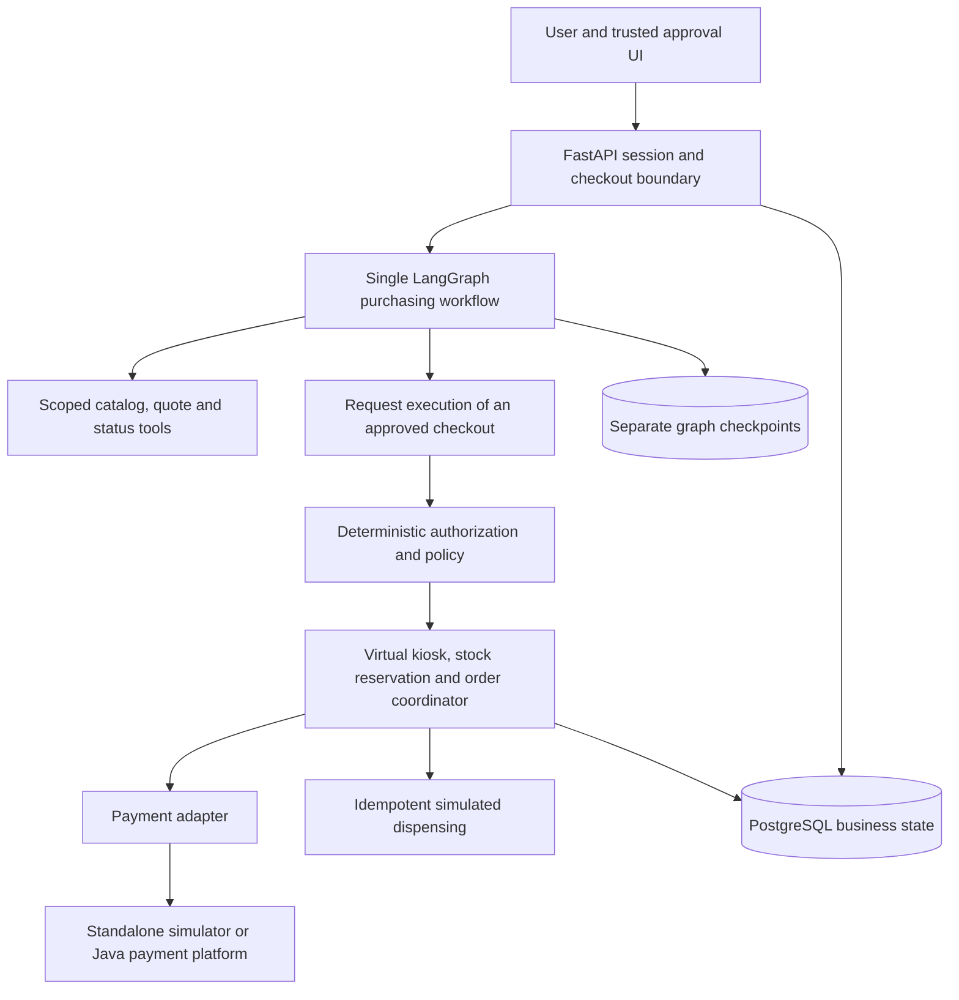

# Agentic Commerce — AI-Powered Autonomous Shopping & Payment Platform

A planned AI purchasing system that selects products at a virtual kiosk, verifies explicit purchasing authority, and coordinates sandbox payment and fulfillment through authoritative backend state.

**Architecture and implementation planning. Application development has not started.**

## Why this project

“Find a protein bar under $4 at Kiosk A and buy it” requires more than an LLM choosing a tool. Price and stock can change, permission can expire, a payment can time out after succeeding, and dispensing can fail after checkout begins. The agent must act within the user's authority and report what actually happened.

I am building this project to study applied AI engineering at the boundary between interpretation and consequential business workflows: typed tools, deterministic authorization, commerce state, durable execution, adversarial evaluation, and failure recovery. The initial system is a software simulation of unattended retail, with no real vending hardware or funds.

## Proposed approach

- Start with one user, one kiosk, a small catalog and explicitly human-approved sandbox purchases.
- Use one LangGraph agent to interpret requests, compare candidates, request approval and monitor outcomes.
- Keep prices, inventory, spending permissions, checkout, payment and dispensing decisions in deterministic application modules.
- Bind approval to immutable checkout details; reject replay, changed price, expired/revoked permission and unauthorized merchant/product.
- Add delegated autonomous purchases only after the complete human-approved workflow passes its acceptance tests.
- Integrate with the [Java payment platform](https://github.com/sontiachyut/payment-processing-cleanroom-implementation) through versioned commands/events; use a narrow simulated provider independently.

## Proposed architecture

All components below are planned logical boundaries; the first version does not require six deployed services.

The agent does not hold signing keys, user credentials or raw payment mutation authority. Its execution request is checked by the backend against current approval, quote, inventory and command identity. Final user messages must reflect authoritative order, payment and fulfillment state.

## Public engineering references

[Medusa](https://github.com/medusajs/medusa) informs commerce modules, reservations and compensating workflows; [Google AP2](https://github.com/google-agentic-commerce/AP2) informs verifiable purchasing authority and checkout binding; [LangGraph](https://github.com/langchain-ai/langgraph) provides stateful orchestration, checkpoint and human-interrupt patterns. [Reference analysis](docs/reference-analysis.md) records pinned source files, inspected tests, licensing, limitations, and ideas adopted/rejected.

This is an original smaller design, not a port of Medusa or a claim of AP2/UCP/ACP/TAP compliance. Protocol interoperability is optional later work with explicit conformance gates.

## Planned stack

| Layer | Baseline and purpose |
| --- | --- |
| API/data | Python 3.12, FastAPI, Pydantic, PostgreSQL, SQLAlchemy, Alembic |
| Agent | LangGraph; one OpenAI or Anthropic provider selected through evaluation, with deterministic fakes for ordinary tests |
| Reliable work | Durable PostgreSQL business jobs/checkpoints first; Celery/Redis only when a demonstrated worker requirement justifies them |
| Operator/user UI | React, TypeScript, Tailwind; trusted approvals and distinct order/payment/fulfillment views |
| Evaluation/visibility | Langfuse, OpenTelemetry, bounded redacted traces; versioned evaluation corpus |
| Verification | pytest, Testcontainers; k6 for deterministic simulator load, not an LLM loop |
| Environments | Docker Compose locally; GitHub Actions and AWS ECS only in later separately approved work |

Full-text/pgvector, MCP, OpenFGA, Temporal, Kubernetes isolation and multiple agents are optional decisions, not initial requirements. [Architecture and adoption](docs/architecture.md).

## Engineering depth

The [ten mandatory commerce scenarios](docs/production-scenarios.md) cover human approval, delegated budgets, price changes, last-item races, duplicate execution, expiry/revocation, paid-but-failed dispensing, agent crash recovery, prompt injection and forbidden merchant/product selection.

Key decisions: business state independent of graph state; exact backend policy before financial effects; atomic inventory/budget reservation within commerce; explicit cross-system saga and uncertainty; idempotent dispense commands; human-first MVP. No single transaction spans commerce, payment processor and fulfillment. [ADRs](docs/adr/001-boundaries.md).

## Roadmap and validation

| Milestones | Planned outcome |
| --- | --- |
| 0 | Source research, architecture, documentation; current authorization only |
| 1–4 | API/business-state foundations, kiosk model, bounded agent and discovery tools |
| 5–6 | Trusted approval, deterministic policy, checkout/reservations and standalone payment slice |
| 7–8 | Delegated authority, revocation/replay protection, durable recovery and concurrency |
| 9–10 | Java integration, compensation, full evaluation/security/observability and approved deployment |
| Optional 11 | Protocol interoperability, external agent identity and stronger isolation |

All application milestones are unstarted and require explicit approval. [Detailed plan](docs/implementation-plan.md) and [learning roadmap](docs/learning-roadmap.md).

No executable application, agents, API scaffold, migrations, automated tests or infrastructure configuration exists yet. Running instructions will be added as working milestones are verified. There are no measured accuracy, latency, cost or throughput results.

Validation is designed before implementation: deterministic money/stock/policy checks, real-database races, crash/replay/compensation tests, separate held-out model evaluation, and a source-of-truth reporting gate. High-volume testing uses deterministic simulators; Stripe sandbox and LLM APIs stay outside the load lane. [Evaluation](docs/evaluation-plan.md) and [testing](docs/testing-strategy.md).

## Technical documentation

- [Requirements](docs/requirements.md), [reference analysis](docs/reference-analysis.md), [architecture](docs/architecture.md)
- [Commerce domain](docs/commerce-domain-model.md), [kiosk and checkout](docs/kiosk-and-checkout-design.md)
- [Agent workflow](docs/agent-workflow-design.md), [authorization and mandates](docs/authorization-and-mandates.md)
- [Payment contracts and shared recovery flows](docs/payment-integration-contracts.md)
- [Ten production scenarios](docs/production-scenarios.md), [security](docs/security-design.md), [evaluation](docs/evaluation-plan.md)
- [Implementation plan](docs/implementation-plan.md), [learning](docs/learning-roadmap.md), [testing](docs/testing-strategy.md)
- [Risks](docs/risks-and-constraints.md), [future approved-milestone workflow](AGENTS.md)
