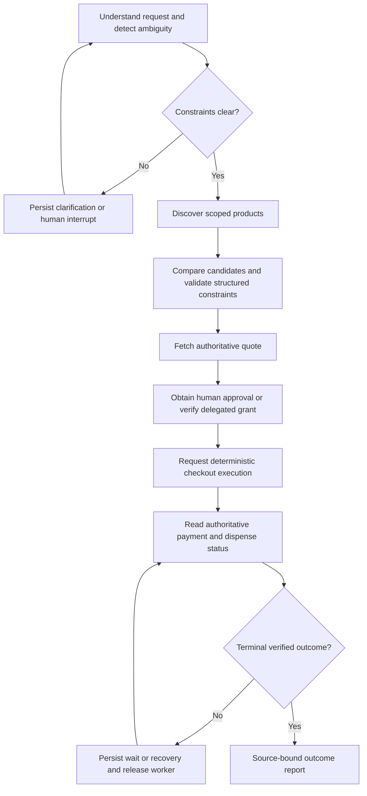

# Proposed bounded purchasing workflow

One LangGraph workflow with specialized typed tools; no default multi-agent architecture. Agent planning interprets natural language and compares eligible products. Backend policy gates consequential actions. No node/tool implementation exists.

## Node and state contracts

Frozen run context: trusted user/agent/session IDs, session revision, graph/prompt/tool/report versions, chosen model/provider, allowed kiosk/source set and round/time/token/cost budget. Typed state: original text, tentative intent, clarification refs, candidate IDs/structured scores, quote ID/hash/version, approval/grant ref, execution/order/payment/dispense refs, bounded tool observations, source timestamps, safe errors, counters and final report reference.

State stores references and bounded sanitized excerpts, not full secrets/catalogs/logs or unlimited chat history. Reducers must deduplicate replayed logical results. Graph version changes require explicit checkpoint migration or new run; do not silently load old serialized state into incompatible nodes.

| Tool | Input under trusted scope | Output / constraint |
| --- | --- | --- |
| search_products | Kiosk ref and typed filters, bounded query/page | Structured attributes, price version/availability observation; descriptions untrusted |
| get_quote | Candidate ID/quantity/kiosk | Immutable authoritative total/currency/hash/expiry; no inventory promise |
| request_approval | Session/quote refs | Trusted UI approval request/status; cannot itself approve |
| get_authority_status | Owner-bound approval/grant ref | Current scope/validity/version and deterministic eligibility; no secrets |
| request_checkout_execution | Checkout+authority+expected quote refs, logical idempotency identity | Backend revalidates everything; 202 execution or typed denial; agent cannot choose raw amount/payee |
| get_execution_status | Case-bound execution ref | Separate authoritative order/payment/fulfillment states with source IDs/time/version |
| request_clarification | Typed missing/ambiguous preference | Human interrupt request; resume authenticated/validated |

No raw authorize/capture/refund, arbitrary URL/SQL/shell/browser, permission-edit/signing or direct dispense tool. Agent executes a scoped approved business action; the trusted coordinator owns financial and fulfillment transitions. Tool arguments are checked semantically and for authorization even when the model obeys JSON Schema.

## Model roles, context and limits

Model-assisted tasks: extract uncertain user intent; rank candidates against preferences; propose permitted next tool; explain observed outcome. Deterministic tasks: money, stock, quote hash, grant checks, approval/nonce, saga next action, budget/admission and final success classification. Structured outputs constrain format, not truth or authorization.

Start fake model, then one selected OpenAI/Anthropic adapter behind a narrow interface after approved usage. Handle schema invalidity, refusal, truncation, timeout and rate limit separately; one bounded repair for formatting only, never for fabricating a status. Record model/prompt versions, tokens, attempts, deadlines and price snapshot for later cost estimation. No actual model choice/usage result exists yet.

Budget instructions/schema/tool outputs and output capacity explicitly. Keep decisive structured constraints and contradictory/error observations; do not let large product descriptions evict them. Retrieved/merchant text is data and may contain malicious instructions. Current exact catalog queries do not require RAG/vector storage.

## Durable execution and replay

Business execution is persisted before any remote financial/dispense effect. A resumed graph first reads execution status; it never creates a fresh checkout because its previous tool response disappeared. Persist logical tool-result identity and source refs; same execution request replays existing resource. A provider call may complete before its result is saved, so graph checkpointing cannot provide exactly-once effects or billing.

Use stable thread ID per agent run, not a global user ID shared by simultaneous purchases. PostgreSQL saver is separate from business records. Interrupted nodes can restart from their beginning; any pre-interrupt effect must be idempotent. Human approval is stored by trusted backend, not merely an interrupt answer copied into graph state.

Start serialized graph execution. Before concurrent takeover, validate owner/fence in the same DB transaction as checkpoint/pending-write mutations; a separate advisory lock/lease alone does not fence a saver on another connection. Otherwise retain a serialized runner and document availability limits. Domain state/unique execution guards remain correct independently of graph failure. Human/payment waits persist and end the active worker invocation; scheduler resumes later.

## Reporting gate

Backend supplies a typed outcome summary referencing authoritative versions/receipts: selected product, approved amount/currency, order/execution ID, payment state, fulfillment state, compensation status, remaining uncertainty and next permitted user step. LLM may phrase it; deterministic validation rejects invented completed/paid/dispensed/refunded claims. Terminal successful purchase requires the defined capture and dispense confirmations. UNKNOWN remains “pending/needs recovery,” not cheerful completion.

References: [LangGraph source/test analysis](reference-analysis.md), [official tool calling](https://developers.openai.com/api/docs/guides/function-calling), [structured outputs](https://developers.openai.com/api/docs/guides/structured-outputs). These vendor features do not certify our transaction correctness.
