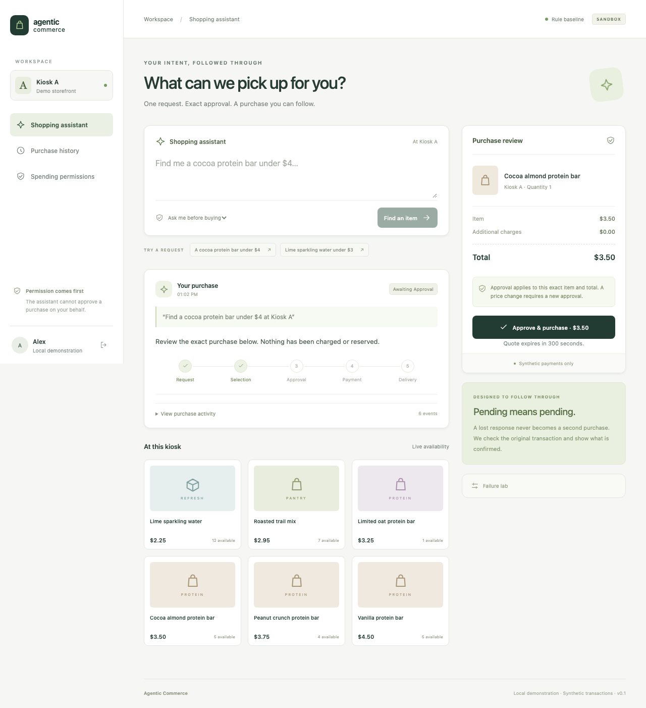

# Client demonstration — five minutes

## Product promise

A request becomes a controlled purchase with an explainable outcome. The model handles flexible language; the application controls authorization, inventory, payment and recovery. The demonstration uses a virtual kiosk and synthetic funds. It does not connect to a client's live systems.

## Preparation

Follow the [runbook](operations-runbook.md). Use Codex mode for the real agent demonstration and verify local sign-in/allowance beforehand. Use baseline mode only when clearly labeled as a deterministic system walkthrough. Keep an ordinary product in stock and allow five minutes for quote expiry. Do not run a load suite during a live model demo.

## Walkthrough

1. **The request.** Enter Alex's workspace and say: “Find a cocoa protein bar under $4 at Kiosk A.” Explain that a useful outcome is a real recorded workflow, not a persuasive chat response. The agent extracts constraints, searches eligible products and selects from backend candidates.
2. **The decision boundary.** Review the exact $3.50 quote, product, kiosk and expiry. Show that nothing has been purchased yet. Approve the displayed terms. The model cannot simulate this approval by writing a message.
3. **The result.** Show separate payment and delivery facts, the execution ID and activity. Reload the page and open history. The state comes from durable records rather than the model's conversation memory.
4. **The failure worth paying to avoid.** Open Failure lab, choose lost payment response, and repeat with another stocked product. The source commits authorization and then loses its response. The worker records uncertainty, inquires the same command and completes the original execution. Explain why creating a second charge would be the wrong recovery.
5. **The operator.** Enter the local operator persona. Show unresolved/recovery cases and activity. Use a synthetic source outage to demonstrate retrying the original action. Explain the limits: the operator cannot invent success or force-release uncertain financial holds.

Optional: create a scoped spending permission, select it, and demonstrate a purchase without a new per-item approval. Explain per-purchase and lifetime budget, scope, expiry and revocation. Previously accepted effects are not undone by revocation.

## Questions a technical reviewer should ask

- What commits atomically, and what happens after that transaction ends?
- Why does the same quote still produce one execution if the transport key changes?
- How do unknown source outcomes differ from confirmed failures?
- What protects inventory and budgets when two connections race?
- Can the model or an MCP client grant its own authority?
- What survives a worker/API restart, and what does a database restore require?

Use the [engineering guide](engineering-guide.md) and tests to answer with code, not only a diagram.

## Client adaptation

The stable seam is the internal purchasing workflow and typed source adapter. A client engagement would first define one bounded catalog/merchant workflow, identity and approval requirements, supported model hosting, provider contracts and measurable acceptance criteria. Then add the client's inventory/payment/fulfillment adapters without moving authority into model prompts.

The current source is deliberately synthetic. This is a demonstrable implementation foundation, not an already integrated payment product. External AP2/TAP/UCP/ACP profiles, commercial inference, production authentication, deployment, operational targets and licensing require completion before a client launch. No regulatory or payment-network certification is implied.

## Workspace preview

[Mobile workspace](assets/mobile-workspace.png). These images contain only seeded synthetic identities and products.
