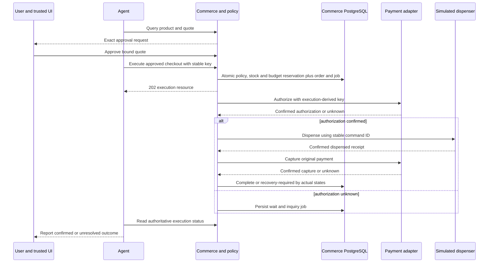

# Proposed virtual kiosk, checkout and compensation

The kiosk is a deterministic software simulation, not hardware controlled through a payment terminal. No catalog, inventory or commerce API has been implemented.

## Public commerce boundary

Proposed `/api/v1` resources: sessions/clarifications; kiosk catalog with structured filters; immutable quotes; trusted approval requests/decisions; delegated grants/revocations; checkout execution; order/payment/fulfillment status; attributed audit. APIs validate identities, typed fields and bounded sizes; the model never supplies its trusted user/agent scope.

| Command/read | Responsibility and proposed response |
| --- | --- |
| GET /kiosks/{id}/products | Allowlisted kiosk, structured price/category filters, bounded page; catalog version and approximate availability |
| POST /quotes | Product/quantity/kiosk → authoritative total/currency, price version, expiry/hash; no stock guarantee |
| POST /approval-requests | Session+quote refs → trusted UI resource; not executable financial authority by itself |
| POST /approval-requests/{id}/decisions | Authenticated user, expected quote/version, approve/deny → immutable bound one-use receipt |
| POST /checkouts/{id}/executions | Approval/grant ref, expected quote/version, idempotency key → 202 stable execution/order/status links after atomic reservation |
| GET /executions/{id} /orders/{id} | Separate authoritative payment and fulfillment state, unknown/recovery reason and source timestamps |
| POST /grants/{id}/revocations | Owner, expected version/idempotency → committed versioned revocation; in-flight semantics explicit |

Initial private module methods can implement these responsibilities before every HTTP route is useful. Read routes cannot be promoted into raw arbitrary SQL/query/URL tools.

## Human-approved happy path

Discover candidate→quote→trusted approval→execution revalidation→reserve stock/budget/create order+job→authorize payment→confirm authorization→simulate dispense→confirm dispensing→capture→confirm capture→complete order. Stock reservation occurs **before** external payment so a known out-of-stock item does not receive a new authorization. This is an original simplification, not a claim to use Medusa's exact ordering.

Default manual-capture mode avoids capturing when dispensing is known to have failed. It has an unavoidable tradeoff: goods can be dispensed before capture later fails. That becomes financial recovery work, never another dispense. An alternate already-captured fixture exercises refund compensation and must be explicit, not a hidden change in charge timing.

## Inventory concurrency and expiry

Lock authoritative inventory level and conditionally reserve if stocked−reserved≥quantity; write reservation/order in the same transaction as policy/usage. Two agents reading “1 left” does not grant either inventory. Unique execution/SKU guards protect replay; sorted lock order prevents avoidable multi-SKU deadlocks later.

A held reservation can expire only when no dispatched/unknown payment or dispense needs it. Before authorizing, verify reservation remains held. Once remote effects may exist, convert to resolution hold rather than TTL release. Unknown dispense quarantines quantity; no second buyer receives stock that may already have left. Confirmed dispense decrements stock+reserved once; confirmed no-dispense releases appropriately. Operator reconciliation is simulated and audited.

## Saga and compensation matrix

| Actual observed state | Deterministic next action | Must not do |
| --- | --- | --- |
| No payment dispatched, execution canceled | Cancel job, release stock/usage, preserve audit | Start payment after cancellation |
| Authorization unknown | Retain reservation/usage, inquire original operation | New authorization/key, dispense, or claim decline |
| Authorization declined | Release unused reservations; mark known failure | Report purchase complete |
| Authorized, dispense not started, cancellation/known inability | Idempotent cancel/void if supported; await confirmed compensation | Treat request acceptance as funds released |
| Authorized, dispense failed-confirmed | Avoid capture, cancel/reverse as capability allows | Refund an uncaptured payment or repeat dispense blindly |
| Dispense unknown | Retain stock/financial resolution hold; inquire same dispense command | Release inventory, repeat dispense, automatic refund |
| Dispensed, capture unknown | Inquire original capture, retain recovery state | Dispense again or switch payment processor |
| Dispensed, capture known failed | Controlled recovery/escalation under original authority; bounded same-action retry only if safe | Create a new purchase/payment to hide failure |
| Already captured, dispense failed-confirmed | Durable policy-approved refund tied to original capture, stable compensation key | Give LLM a refund tool or claim refund complete before confirmation |
| Refund/cancel unknown | Inquire original compensation; preserve pending recovery | Reissue under a new key, release budget based solely on timeout |

Compensation is a new durable action, not distributed rollback. A user purchase approval includes clearly displayed fulfillment-failure compensation policy; service-scoped compensator may void/refund only linked original effects under that policy. It cannot charge additional money or alter the product. Audit reason, policy version, authority and operation IDs.

## Simulated dispenser contract

`request_dispense(command_id, execution, kiosk, SKU, quantity, item_digest)` returns accepted/status/receipt; `get_dispense(command_id)` retrieves canonical result. The simulator stores one effect per stable command separately from agent/commerce workers. Same ID/changed item conflicts. Fault modes: fail before effect, dispense then lose response, late receipt, status temporarily unavailable and duplicate delivery. No timeout is converted to FAILED_CONFIRMED. Device expiry/deadline cancellation can only be claimed if its implementation actually guarantees no later effect.

Real hardware would need authenticated device firmware, durable command receipts, sensing, safety/interlock, offline reconciliation and certification beyond this simulation. Do not describe a payment authorization as evidence an item physically left a machine.
