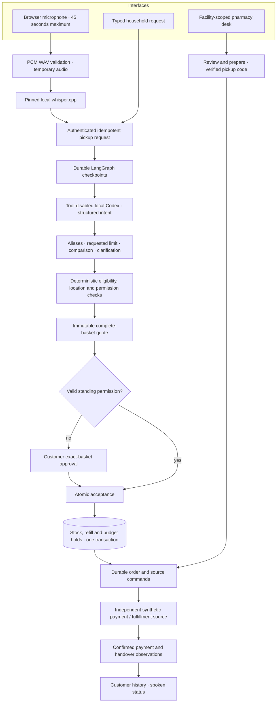

# Family Pickup — architecture and engineering decisions

Asterfield is a local synthetic pharmacy coordination product. Its current integration boundary is a saved-routine/refill fixture, not a prescribing or insurer system. The old general-retail engine is preserved separately.

## Ownership and boundaries

The model sees the request and known family aliases. It does not receive prescription names, home coordinates, payment instruments, signing keys or source credentials. It cannot create a permission or invoke purchase tools. The graph controls the workflow sequence; this does not imply measured model tool-selection accuracy.

Browser voice and text converge before business processing. Audio is validated and recognized locally in a temporary directory. Local Qwen3-TTS speech is presentation; its status sentence is constructed from recorded backend facts. The client recording uses a disclosed synthesized command injected into Chromium's microphone input. It still exercises the real recorder, WAV endpoint, recognizer, model, graph, database and source services.

## Separate persistent concepts

| Entity | Owns |
| --- | --- |
| Household and family member | Saved home, approved caregiver access and access version |
| Routine item | Fixed saved package, existing refill eligibility, confirmed synthetic price, remaining/held refills |
| Facility / facility stock | Opening hours, authored coordinates, available and reserved packages |
| Pickup permission | Member/routine/facility scope, per-order and total allowances, held/spent amounts and counts, expiry/revocation |
| Pickup request | Authenticated text/channel, provider, idempotency binding, intent, progress and planning lease |
| Family quote | Immutable full basket, access/price versions, eligible location, request limit/comparison and expiry |
| Family order | One quote/permission, independent payment and handover state, worker stage/lease/version |
| Source command journal | Independently committed synthetic financial/fulfillment effects, stable identity and inquiry |

The standard basket is $40.98 for four fictional people. Northbank is closer but lacks a required package; Cedar Square is the nearest eligible complete-basket location. These prices and locations are authored fixtures, not retailer data or geographic service promises. Demo helpers fix the facility-hours clock to 18:05; quote and permission expiry still use wall-clock time. Native mode uses the current local time unless that documented demo override is set.

## State and truth

```mermaid
stateDiagram-v2
    [*] --> QUEUED
    QUEUED --> PLANNING
    PLANNING --> NEEDS_INPUT: Missing people or budget
    PLANNING --> BLOCKED: Access, refill, coverage or stock
    PLANNING --> BUDGET_EXCEEDED: Whole basket exceeds request
    PLANNING --> AWAITING_APPROVAL: No eligible spending permission
    AWAITING_APPROVAL --> ORDERING: Exact quote approved
    PLANNING --> ORDERING: Eligible standing permission
    ORDERING --> ORDERED: Source confirms authorization
    ORDERED --> READY_FOR_PICKUP: Staff prepares; source confirms capture
    ORDERED --> CANCELED: Staff rejects; authorization canceled
    READY_FOR_PICKUP --> PICKED_UP: Code checked; source confirms handover
```

Order-level transient states distinguish PAYMENT_PENDING, CAPTURE_PENDING, CANCEL_PENDING and PICKUP_CONFIRMING. Unknown responses retain the appropriate holds and do not advance user-visible success. Repeated unresolved attempts or conflicting source observations require review. A ready notification is not a physical collection receipt.

## Atomicity, concurrency and recovery

Acceptance locks the quote and request, then eligible permissions, members, saved routines and stocks in deterministic order. It rechecks immutable terms, requested budget, access/price versions, refill availability and held-plus-spent authority. Stock, refill and budget holds and the durable order commit together. Quote uniqueness and a quote row lock make concurrent duplicate acceptance return one order. Different quotes competing for the same existing refill cannot both reserve it.

Source calls happen outside database transactions. Stable order/action identities and inquiry reconcile response loss without creating another charge. A lease token and order stage/version fence stale observations. Rejecting an authorized order cancels the source authorization before releasing holds. Capture consumes the budget/refill allocation; confirmed handover consumes reserved stock. The system does not claim universal exactly-once network delivery.

Customer cancellation only applies before submission to the pharmacy. Cancellation and acceptance serialize on the request row. Once submitted, the customer is directed to pharmacy staff rather than being told that external effects were undone. Staff cannot force an unknown financial result to success.

## Identity and privacy

Opaque revocable server-side browser sessions, CSRF, trusted origin/host checks and tenant/user scoping are shared with the preserved engine. Optional Keycloak Code + PKCE is available locally. Caregiver access is separate from purchasing permission and is checked again before staff progression. Customer views mask saved clinical item details after access is revoked. Staff queues are restricted to assigned facilities. Pickup codes are shown to the owning customer only when ready and checked with constant-time comparison.

This is a loopback-only synthetic candidate. No claim is made about healthcare regulatory certification, a production identity administration program, broad abuse/load testing or real clinical safety. Pickup verification still needs production abuse controls and client-specific identity rules before public service. A real pharmacy integration must supply authorized eligibility, pricing, preparation, cancellation and handover contracts.

## Protocol and deployment boundaries

MCP is read-only integration access to authorized saved routines and pickup status; it does not confer purchase authority. Existing AP2, TAP-style, UCP and ACP components belong to the preserved retail interoperability candidate and have not been bound to multi-item pharmacy quotes. External conformance, merchant/payment enrollment and trusted issuer lifecycle remain unverified.

Native execution currently supplies the local Codex, whisper.cpp recognition and optional Qwen3-TTS/MLX natural speech runtimes. The neural speaker is a persistent, serialized subprocess with an eight-utterance in-memory cache, bounded inputs/deadline, supplied preset voices and no application credentials. It loads checksum-pinned local model files with Hugging Face/Transformers offline mode. The authenticated endpoint accepts a request ID and current state, constructs its sentence from owned backend facts, and rejects arbitrary prose or stale state. The application image includes the pharmacy UI and recorder asset, but those local executables/models are not bundled into the base image. A future supported inference adapter, client pharmacy adapter and entitled native CarPlay client can connect at these boundaries. None is silently simulated as completed integration.
