# Product and system boundaries

## Product hypothesis

A buyer needs a flexible request to become a controlled purchase with a recoverable, explainable outcome. A client needs to connect that behavior to its own catalog, identity, purchasing permissions and merchant/payment systems. The product's value lies in the complete workflow: current data, exact consent, durable execution, reconciliation and operator visibility.

The initial supported product remains one virtual kiosk, one item per purchase, USD, synthetic payment/fulfillment and an owner-operated local model runtime. Richer protocol envelopes must not silently turn this into an unbounded shopping browser. External client demand has not been validated through customer interviews; standards adoption is not evidence that a particular client wants every protocol.

## Roles and authority

| Role | Responsibility | Boundary |
| --- | --- | --- |
| Shopper | Describe the goal and approve exact terms or a scoped delegation | Cannot be inferred from model prose |
| Shopping agent | Interpret, clarify, discover and select within supplied candidates | Cannot issue its own human authority or edit financial facts |
| Trusted surface | Display authentic terms and record authenticated consent | Signing requires verified consent, never arbitrary model payloads |
| Merchant | Own catalog, current checkout terms and order acceptance | A profile or signature does not guarantee available stock |
| Credential provider / payment source | Verify scoped payment authority and report financial effects | Credential data stays outside model context |
| Fulfillment source | Report whether delivery actually occurred | Unknown delivery is not confirmed failure |
| Operator | Diagnose/reconcile within explicit permissions | Cannot fabricate payment success or force-release uncertain holds |

```mermaid
flowchart LR
    Intent[Untrusted natural-language intent] --> Agent[Bounded decision component]
    Agent --> Quote[Authoritative merchant terms]
    Quote --> Consent[Trusted exact approval]
    Consent --> Gate[Transactional policy and reservation]
    Gate --> Execution[Durable execution]
    Execution --> Facts[Independent payment and delivery facts]
    Facts --> UI[Truthful result and recovery]
```

These are logical roles, not a requirement for seven LLMs or seven services. One bounded graph remains appropriate. Cryptographic verification, policy and transaction state are deterministic code. AP2 explicitly separates agentic interpretation from verification/consent responsibilities. [AP2 roles and verification](https://ap2-protocol.org/ap2/specification/).

## User journeys to finish

1. A clear request produces eligible candidates and an exact quote, with all supported constraints preserved.
2. An incomplete, unsupported or contradictory request explains what is missing; it does not silently invent currency, quantity, attributes or payment permission.
3. Approval displays item, quantity, merchant, currency, total, instrument when applicable, expiry and relevant fees. Changed terms require new consent.
4. A selected delegation can permit a purchase without a fresh per-item approval, but only within current scope and held-plus-spent limits.
5. An uncertain completion remains visible through reload/restart. Recovery uses original business identity and adapter-specific inquiry.
6. An operator can understand the current stage and why it stopped, without secret-bearing payloads or fabricated source outcomes.
7. A client can replace identity/model/merchant/source configuration at stable boundaries and run the same invariant tests.

## Constraint representation gaps found in v0.1

The current intent has `max_amount_minor` but no comparison operator or currency field. Discovery and quote validation use `price <= max`. The original evaluation plan states that “under” is strict. Add explicit strict/inclusive comparison and currency, preserve them through interpretation, filtering, quote preparation and evaluations, and revalidate at the consequential boundary. Do not interpret a request in another currency as USD without clarification.

Quantity-one is a product constraint. Unsupported quantities should produce a useful clarification, not an unexplained model/schema failure or a silently reduced order. Attribute evidence must come from catalog data; a product name is not proof of a dietary or safety property. These are goal-correctness concerns even when exact human approval prevents an unintended charge.

## Deliberate exclusions

No general web checkout automation, real card handling, medical advice, arbitrary model-selected URLs, vector database, Kafka, Kubernetes or multi-agent topology is needed to establish the initial product. Add a component only when its supported requirement and validation benefit are explicit. Use exact catalog filtering and structured product evidence before semantic retrieval.

For prospective clients, validate catalog access, supported merchant operations, identity/consent ownership, payment onboarding, recovery authority, acceptable latency and operational support responsibilities. Those answers determine which adapters and deployment profile are valuable; the project should not claim proven market fit before that work.
