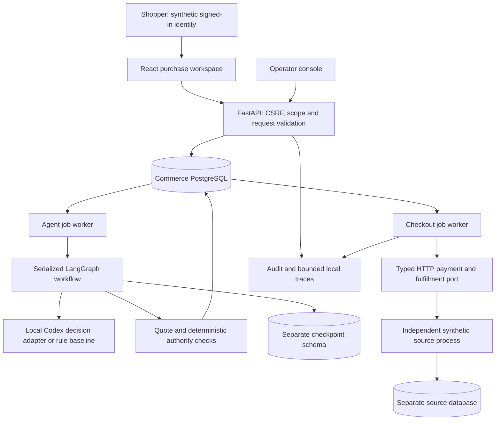
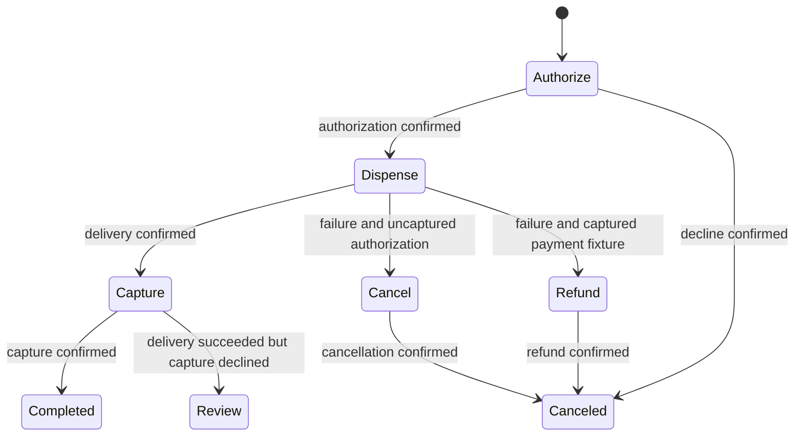

# Runtime architecture — v0.1

This describes executable code. Older design documents describe the broader target and should be read alongside [status](STATUS.md).

## Ownership

| State | Authoritative owner | Code |
| --- | --- | --- |
| Request and tentative intent | Purchase session | `service.py`, `agent.py` |
| Price snapshot and exact approval | Quote / approval records | `service.py` |
| Delegated scope and held/spent limits | Grant row under lock | `service.py` |
| Available and reserved inventory | Product row / execution reservation state | `service.py`, `worker.py` |
| Order and saga progress | Order / execution / job records | `worker.py` |
| Financial and dispense effects | Separate synthetic source database | `simulator.py` |
| Agent node progress | PostgreSQL LangGraph checkpoints | `agent.py`, `api.py` |
| Final success classification | Confirmed capture plus confirmed dispense | `domain.py` |

## Acceptance transaction

Lock the quote, reload current authority, lock a grant if used, then lock the product. Validate owner, quote digest/expiry, exact price/version/currency, authority scope/version and stock/budget. Commit the stock and budget hold, one order, one execution, consumed human approval, audit event and job together. Remote calls occur after commit, without holding these row locks.

One unique quote-to-execution binding prevents creating another purchase by changing a transport key. Scoped request uniqueness also prevents a key from silently switching to another checkout. Same-checkout retries return the existing execution, including after approval consumption.

## Checkout saga

Any source timeout preserves the current action and held resources. The next attempt inquires the same source command. A 404 permits retry of that same command identity; it does not create a new payment. A lost source response can therefore be recovered even when the commerce process did not record the effect.

Unknown delivery never means confirmed failure. Do not cancel/refund or deliver again merely because a response is missing. Confirmed delivery consumes stock exactly once. Refunds do not replenish delegated lifetime spend. Capture-declined-after-delivery remains a review case; the application does not claim the goods were returned or payment succeeded.

## Workers and checkpoint ownership

Agent decisions and checkout work use separate workers so a model call does not stall accepted purchases. Job claims use `FOR UPDATE SKIP LOCKED`; claim tokens guard completion. Stage and version checks reject late business observations from an older worker. Source command identity prevents repeated remote effects.

All graph invocations are serialized through a PostgreSQL session advisory lock and a local mutex. It holds an autocommit connection, not an inventory transaction, while inference runs. This is intentionally limited availability and throughput. Graph serialization is not a claim of distributed exactly-once inference or checkpoint fencing during arbitrary database/network partitions.

## HTTP and data boundaries

The source URL is application configuration, not model output. Source requests require a service token. Every source response is checked against execution, action, amount, currency, quote digest, command identity and source profile. Raw payment credentials never appear in model context; there are no real payment credentials in this release.

The model receives bounded request/candidate data and cannot approve, edit permissions or execute raw financial operations. The browser displays backend-owned quote fields. React escapes merchant text. The MCP subset is read-only and shares the authenticated owner boundary.

## Visibility

Audit events record business identities and decisions. Prometheus exposes HTTP count/latency only to the local operator. OpenTelemetry exports whitelisted metadata to rotated owner-only local trace files. Async worker traces correlate through execution IDs; cross-process parent propagation and hosted Langfuse are not implemented.
